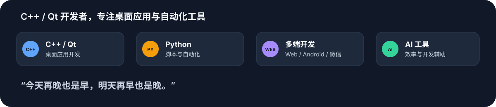
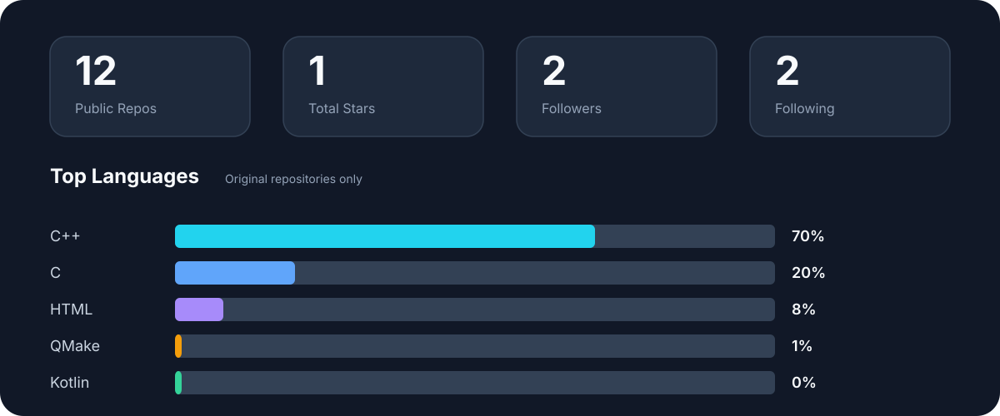
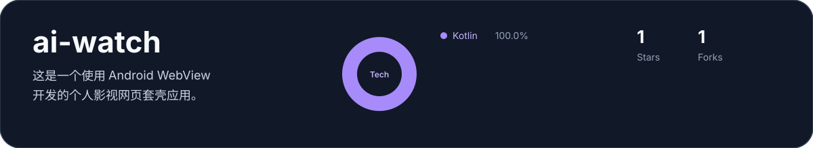

  

  

## 关于我

你好，我是 Harry James，一名 C++/Qt 开发程序员。

  

## 技术栈

  

## GitHub 概览

  

## 精选项目

	

	

## 个人亮点

  

  

## 贡献活动

### 3D 贡献图

  

### 动态贡献贪吃蛇

  

## 联系我

- GitHub：[huizhang557](https://github.com/huizhang557)
- Telegram：[@changfai666](https://t.me/changfai666)
